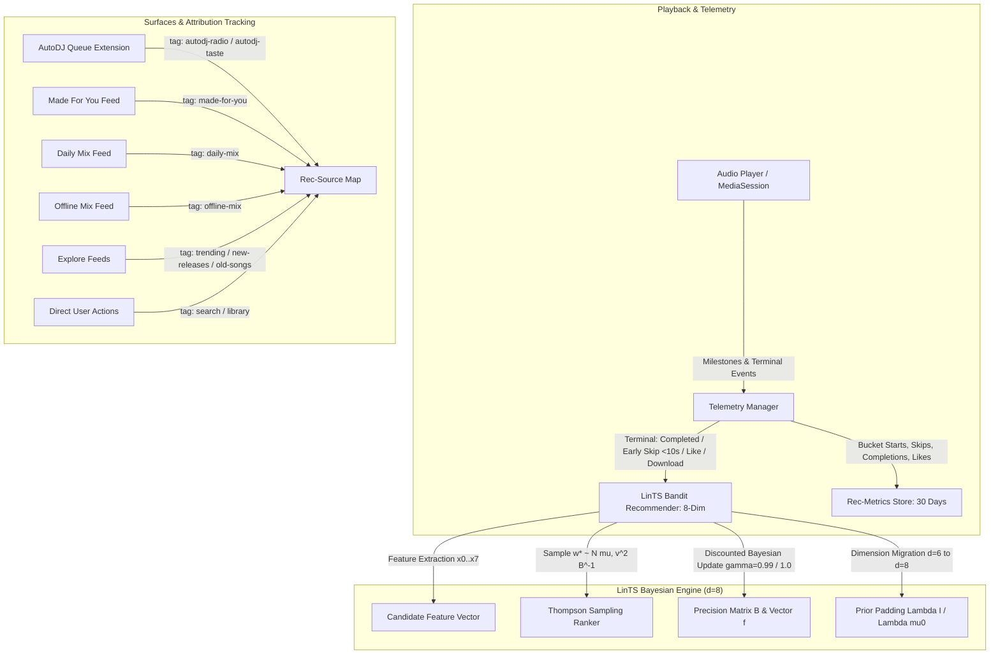

# MelodyMap Recommendation & Taste Engine Plan (Phase 2 Update)

A mathematically rigorous, on-device music discovery and recommendation engine architecture for MelodyMap.

---

## 1. Running Rules & Experiment Hygiene

1. **Change one thing at a time**: Never combine retrieval changes with model or feature changes.
2. **Control for weekday variance**: Compare metrics against the baseline over the same days of the week (listening habits differ significantly between weekdays and weekends).
3. **Revert on regression**: If any step worsens the early-skip rate (<10s) by $\ge 3\%$ or completion rate by $\ge 5\%$, revert it immediately, even if all automated Vitest suites pass.
4. **Offline validation first**: Validate every reward, discount value, or feature adjustment using synthetic simulations with seeded PRNG (`setBanditRngSource`, mulberry32) before enabling in production.
5. **Zero network telemetry leaks**: Aggregate on-device telemetry only (`starts`, `earlySkips`, `completions`, `likes`). Never transmit track titles, artist names, or user IDs off-device.

---

## 2. Deliberately Skipped List

- **Cross-user deep learning / foundation models**: MERT, CLMR, SASRec, and Graph Neural Networks (GNNs) require heavy GPUs, proprietary audio datasets, and cross-user tracking, conflicting with MelodyMap's on-device, private, guest-first design.
- **Server-side ranking & vector DBs**: LightGBM, `pgvector`, and server re-ranking are out of scope until an opt-in cloud sync framework exists with sufficient user scale.
- **Android APK rebuilds for web changes**: Unnecessary for web-only or recommendation changes, because the Android native shell loads the live site. Rebuild only when native Java / Android bridge code changes (`android/**`).

---

## 3. Architecture & Measurement Framework

---

## 4. 8-Dimensional Feature Vector Specification

The Thompson Sampling linear bandit operates over an 8-dimensional feature vector ($x \in \mathbb{R}^8$):

| Coordinate | Feature Name | Description & Formula | Experiment Flag (Default) |
|---|---|---|---|
| **$x_0$** | **Intercept / Bias** | Constant $1.0$ absorbing baseline average reward. | Baseline Core (`true`) |
| **$x_1$** | **Circadian & Mood** | Interaction of time-of-day circadian cycle with candidate audio energy / mood profile. | Baseline Core (`true`) |
| **$x_2$** | **Continuity & Markov** | 60% energy compatibility with predecessor track + 40% Markov genre/style transition affinity. | Baseline Core (`true`) |
| **$x_3$** | **Taste & Affinity** | Normalized user affinity balance from lifetime completions, skips, likes, and downloads. | Baseline Core (`true`) |
| **$x_4$** | **Novelty Preference** | Interaction between discovery slider ratio and artist familiarity ($1.0 - \text{familiarity}$). | Baseline Core (`true`) |
| **$x_5$** | **Pure Language Match** | Candidate language coherence calculated via `getTrackLanguage` against session and preferred languages. | `languageFeature` (`false`) |
| **$x_6$** | **Artist Recent Skip Health** | Rolling skip health over artist's last 10 plays: $1.0 - \frac{\text{recentSkips}}{\text{recentPlays} + 1}$. | `artistRecentSkipFeature` (`false`) |
| **$x_7$** | **Novelty $\times$ Momentum** | Candidate unfamiliarity scaled by positive session momentum / completion streak. | `noveltyMomentumFeature` (`false`) |

### State Migration & Reset
- **6 to 8 Dimension Migration**: Upgrading from $d=6$ to $d=8$ automatically pads precision matrix $B$ along new diagonal axes with prior precision $\lambda I$, and vector $f$ with prior mean $\lambda \mu_0$. Learned user preferences on $x_0$–$x_4$ are preserved.
- **Coordinate 5 Reset**: When `languageFeature` activates, a one-time reset zeros coordinate 5 in $B$ and $f$ (persisted via `safeStorage` key `melodymap.rec_x5_reset_done.v1`) to cleanly purge legacy unnormalized values.

---

## 5. Detailed Task Status & Phase Breakdown

### Phase 0: Baseline & Telemetry Infrastructure (Frozen on `main`)
*All items shipped to `main` prior to the 7-day baseline freeze.*

| Step | Component | Status | Commit |
|---|---|---|---|
| Baseline Telemetry | `rec-metrics.ts`: 30-day bounded counters by surface | **Done** | `b7a6f69` |
| Source Attribution | `rec-source.ts`: Surface tagging cache | **Done** | `b7a6f69` |
| Telemetry Tagging | `telemetry.ts`: Tag events with surface | **Done** | `4c7d509` |
| Discount Factor $\gamma$ | `bandit-policy.ts`: Persisted $\gamma = 0.99$ discounting | **Done** | `3e06715` |
| Single-Pass AutoDJ | `extendQueue`: Single-pass candidate ranking | **Behind flag** (`singlePassRanking` = `true`) | `4c7d509` |
| Train on Full Track | Metadata caching for bandit training | **Behind flag** (`trainOnFullTrack` = `true`) | `3e06715` |
| Metrics Export UI | Settings modal export button | **Done** | `754b01b` |
| Config Change Tracking | `configChangedAt` and 7-tap developer gating | **Done** | `4e4cee7` |

---

### Phase 2: Algorithm, Retrieval & Engine Tasks (Shipped on branch `rec-phase2`)

| # | Task | Description | Status | Commit |
|---|---|---|---|---|
| **1** | Complete Source Attribution | Tag every `playSong` and `startQueue` call site across all UI surfaces; fixed play-time search/library attribution. | **Done / Shipped** | `b7b1492` |
| **2** | Leak-Free Training Context | Synthetic session context rewinding predecessor track and excluding current event mutations during training. | **Behind flag** (`leakFreeTrainingContext` = `false`) | `7a577b6` |
| **3** | Language Feature Spread Stat | Compute and record standard deviation of candidate language features per batch; wire into metrics export. | **Done / Shipped** | `0ab8a86` |
| **4** | Candidate-Varying Features $x_5$–$x_7$ | Expand bandit to $d=8$; implement language match, artist recent skip LRU, novelty $\times$ momentum, and state migration. | **Behind flags** (`languageFeature`, `artistRecentSkipFeature`, `noveltyMomentumFeature` = `false`) | `c65db35` |
| **5** | Synthetic-User Convergence Tests | Seeded simulation suites (mulberry32 PRNG) testing 3 synthetic personas across 5 seeds with median convergence assertions. | **Done / Shipped** | `4a9168e` |
| **6** | Movie Preference Tie-Breaker | Restrict movie sort priority in AutoDJ to candidates within 10% score range of top candidate. | **Behind flag** (`movieTieBreaker` = `false`) | `56e8647` |
| **7** | Taste-Artist AutoDJ Mix | Interleave tracks from user's top 5 taste artists into continuous AutoDJ queue extensions based on discovery slider; tagged `autodj-taste`. | **Behind flag** (`tasteArtistMix` = `false`) | `e7da0af` |
| **8** | Truthful Reason Badges | Pure `explainPick` engine generating truthful recommendation chips based strictly on the highest-scoring feature component. | **Done / Shipped** | `b5b5b24` |
| **9** | Proportional Language Quotas | Hare-Niemeyer largest-remainder allocation for multilingual queries with ~1.5x over-fetch buffer and min-1 guarantee. | **Behind flag** (`languageQuotas` = `false`) | `6d185a7` |
| **10** | Offline Mix Feed | Dynamic offline playlist drawing from downloaded IndexedDB blobs (>10KB), ranked by contextual LinTS bandit. | **Done / Shipped** | `6db988f` |
| **11** | Web Audio Equalizer & Crossfade | 10-band BiquadFilter equalizer and equal-power gain crossfade; CORS detection bypass; permanent MediaElementSource. | **Behind flag** (`webAudioEq` = `false`) *(Needs human verification on Android / real devices)* | `dd0d20c` |
| **12** | Pure Metrics Export Builder | Pure, testable `buildMetricsExport` builder guaranteeing privacy (zero track IDs/titles/artists) and export consistency. | **Done / Shipped** | `fe28d3d` |
| **13** | Plan, Flags & Experiment Docs | Complete recommendation plan update and experiment guide in `docs/rec-experiments.md`. | **Done / Shipped** | *(current)* |

---

## 6. Audio DSP & Human Verification Status

### Web Audio Equalizer & Crossfade (`webAudioEq`)
- **Implementation Highlights**:
  - 10 BiquadFilter bands (31Hz lowshelf, 62Hz–8kHz peaking, 16kHz highshelf) connected in series with a preamp gain node.
  - Safe, permanent `MediaElementAudioSourceNode` connection created exactly once to prevent browser IllegalState exceptions.
  - Neutral bypass: When disabled or flat, gains are set to 0.0 dB and preamp gain to 1.0 (neutral pass-through without tearing down audio nodes).
  - CORS Detection: `isSourceWebAudioEligible` detects unproxied Saavn CDN streams (`*.saavncdn.com`). Because Saavn lacks CORS headers, routing through Web Audio would cause silence. The engine cleanly bypasses Web Audio, retains HTML5 playback, and raises a non-blocking toast.
  - Android WebView Resilience: A `visibilitychange` listener ensures suspended `AudioContext` instances automatically resume when returning from the background.
- **Human Verification Requirements**:
  - [ ] **Android WebView Playback**: Verify that enabling the equalizer produces active sound without silence on real Android devices.
  - [ ] **Background Playback**: Confirm audio continues playing when the screen is locked and does not get terminated by Android power management.
  - [ ] **Audio Focus**: Verify audio pauses properly on incoming phone calls and resumes afterwards.
  - [ ] **Equalizer Audibility**: Verify audible frequency shifts when sliders are adjusted in `EqualizerModal`.

---

## 7. Verification & Test Metrics

- **Vitest Suite**: **932 passing tests across 92 test files** (0 failures, 0 skipped, 0 loosened).
- **TypeScript**: Strict typechecking passing cleanly with `tsc --noEmit`.
- **Git Branch Status**: All Phase 2 work cleanly committed on branch `rec-phase2`. `main` remains untouched and frozen for baseline data collection.
